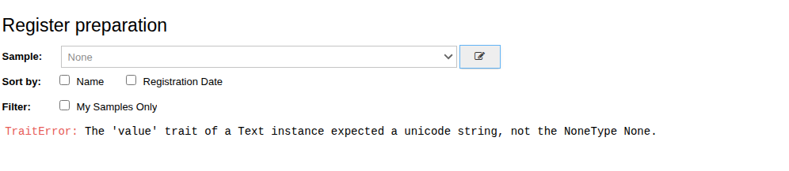
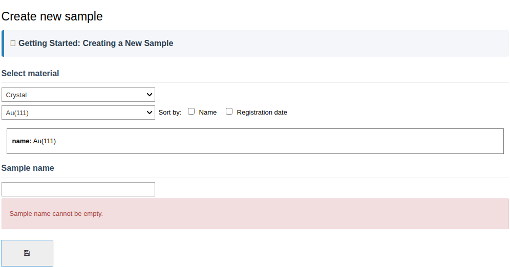
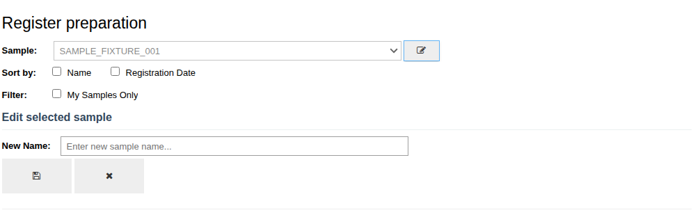
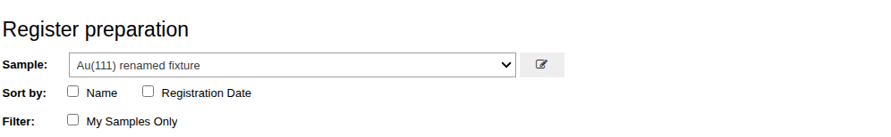

# Sample-name validation and recovery

These are direct, cropped Chromium screenshots of the actual ipywidgets
`CreateSampleWidget` and `SelectSampleWidget`, taken on 23 November 2026.
The callbacks ran with the in-memory Au(111) fixture from
`tests/test_sample_names.py`. No live openBIS objects, demo records, AiiDA
scientific nodes, or installed app sources were modified. The screenshots are
browser element captures, without image retouching or reconstructed controls.

The before case uses unchanged master
`282ac1a986913fbcf3874c03a83a8192b3d36f99`; the after cases use this patch.
IPython's compact traceback mode keeps the original exception fully visible.

## Before: an existing unnamed sample cannot be edited

The selector displays `None`. Clicking its edit pencil raises the original
`Text.value` / `NoneType` trait error.

The same isolated baseline also accepted an empty creation name, displayed
"Sample created successfully!", and retired the previous active sample.
The browser recorded that dialog and the fixture's create/update operations.

## After: reject empty names before changing anything

An empty or whitespace-only name produces persistent validation feedback.
The browser exercised both inputs; neither created a sample nor retired the
existing active one. The selected material and entered name remain available
for correction. Unit cases additionally cover Unicode whitespace.

## After: recover an existing unnamed sample

The sample's openBIS code identifies it in the selector. Its editor opens with
an empty name rather than copying the fallback code into the name field.

Entering `Au(111) renamed fixture` and saving updates the object selected by
its original permId. The refreshed selector retains that same selection and
shows the new name. The fixture verified one update, unchanged code/status,
and lookup by permId rather than by display name.

## Automated regression coverage

Run `python -m pytest tests/test_sample_names.py -q` with test AiiDA state
isolated from the user's profile. The tests stub the openBIS session and writes,
while instantiating real widgets and exercising their button callbacks.

The thirteen cases cover empty/whitespace creation, protection of the previous
sample, valid trimmed creation after a rejected attempt, null/missing/blank
legacy names, sorting, rename by permId, duplicate display names, and rejected
empty renames. On unchanged master, ten fail and three pass; all thirteen pass
with this patch. The existing offline suite also passes: 446 tests total.

This is GUI and callback regression evidence with an isolated backend, not a
claim of a new live-server deployment or production-record repair.
